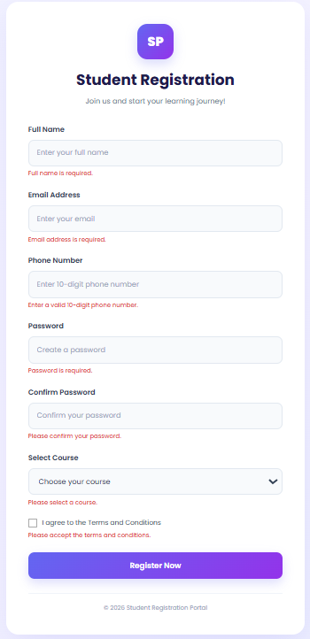
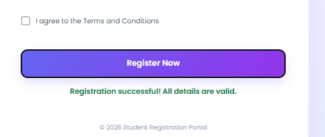

# Student Registration Portal

## ONLEI Technologies – Web Development Internship
### Day 9: JavaScript Form Validation and Interactive Forms

## Project Overview

The Student Registration Portal is a responsive web application developed using HTML, CSS, and JavaScript.

It allows students to enter their registration details and validates the information before displaying a success message.

## Technologies Used

- HTML5
- CSS3
- JavaScript
- Visual Studio Code
- Git & GitHub

## Features

- Modern and responsive user interface.
- Full Name validation.
- Email address validation.
- 10-digit phone number validation.
- Password validation (minimum 8 characters).
- Confirm password matching.
- Course selection validation.
- Terms and Conditions checkbox validation.
- Individual error messages for each field.
- Live input validation.
- Registration success message.
- Mobile-friendly design.

## Project Structure

```text
Student-Registration-Form/
│
├── index.html
├── style.css
├── script.js
├── README.md
│
└── screenshots/
    ├── empty-form.png
    ├── validation-error.png
    └── success-message.png
```

## Validation Rules

1. Full name is required and must contain at least 3 characters.
2. Email must have a valid basic format.
3. Phone number must contain exactly 10 digits.
4. Password must contain at least 8 characters.
5. Confirm password must match the password.
6. A course must be selected.
7. Terms and Conditions must be accepted.

## Screenshots

### 1. Student Registration Form



### 2. Successful Registration



## Testing

| Test Case | Expected Result |
|---|---|
| Empty form submission | Required field errors |
| Invalid email | Email validation error |
| Short password | Password error |
| Mismatched passwords | Password mismatch error |
| Invalid phone number | Phone validation error |
| Valid registration details | Success message |

## Learning Outcomes

Through this project, I learned:

- How to validate HTML forms using JavaScript.
- How to handle form submission events.
- How to use regular expressions.
- How to display dynamic error messages.
- How to validate passwords and phone numbers.
- How to create responsive forms using CSS.
- How to improve user experience with live validation.

## Internship Details

**Organization:** ONLEI Technologies

**Internship Domain:** Web Development

**Day:** 9

**Topic:** JavaScript Form Validation and Interactive Forms

## Author

**Vanshika Khandelwal**

---

This project was developed as part of the ONLEI Technologies Web Development Internship – Day 9 assignment.
